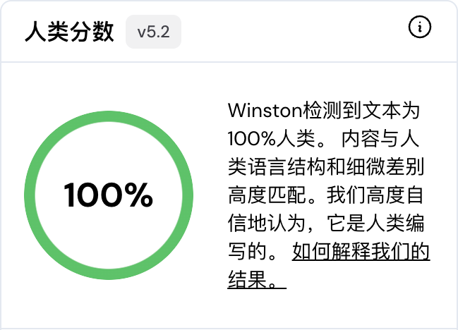
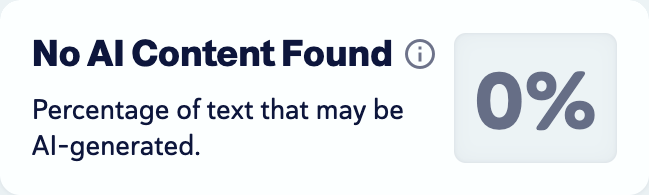

# Expanded detector comparison · 扩展平台对照

The same three source-reviewed HIP versions were compared with six additional or extended service interfaces. This phase completed **31 scans: 15 paired comparisons and one unpaired original**. Full documents and complete paragraph groups are reported separately. Earlier GPTZero, QuillBot and Pangram records bring the project's measured service coverage to nine.

本轮固定三篇原稿与已核对的 HIP 版本，完成 **31 次有效检测：15 组配对及一次未配对原文检测**。全文与完整段落组分开记录；结合此前记录，项目已有九个平台的实测数据。

## Full documents / 全文

Each cell shows original → reviewed HIP, using the provider's native metric.

| Service | Native metric | C1 · Incident response | C2 · Stakeholder analysis | C3 · Healthcare ethics |
|---|---|---:|---:|---:|
| QuillBot | AI indicator ↓ | 60.06% → 21.31% | 38.37% → 10.95% | 58.50% → 4.16% |
| ZeroGPT | AI GPT* ↓ | 70.7% → 29.9% | 34.3% → 11.8% | 88.2% → 36.4% |
| Grammarly | Appears AI-generated ↓ | 44% → 19% | 39% → not scanned | Not scanned |
| Originality.ai | Likely AI ↓ | 90% → 90% | 94% → 90% | 90% → 65% |

QuillBot values carry forward the previously measured identical stored versions; the other rows were measured in this extension. Originality classified the reviewed C3 text as **Mixed**, while its other five full-document results were AI. ZeroGPT described reviewed C1 as mixed signals, and C2/C3 as likely human-written with possible AI parts. Grammarly supplied percentages rather than a Human/Mixed/AI verdict.

QuillBot 沿用此前相同存稿的实测值。Originality 将 C3 核对稿标为 **Mixed**，其他五次结果为 AI；ZeroGPT 对 C1 使用 mixed signals，对 C2、C3 使用 likely human-written 且可能含 AI 部分的描述。各平台保留原生标签。

For the same stored full versions, earlier GPTZero Human probabilities were C1 74%, C2 39%, C3 0%; their classifications were Human, AI Paraphrased and AI Paraphrased. The [model-order comparison](COMBINATIONS.md) separately includes the HIP → Ataraxy alternative.

## Matched complete paragraph groups / 对应完整段落组

| Service | Native metric | C1 | C2 | C3 |
|---|---|---:|---:|---:|
| Sapling | AI-detection score ↓ | 100% → 99.9% | 100% → 21.5% | 100% → 3.9% |
| Winston AI | Human Score ↑ | 0% → 97% | 0% → 99% | 0% → 100% |
| Copyleaks | AI Content ↓ | 100% → 0% | Not scanned | 100% → 0% |

Copyleaks reported **No AI Content Found** for its two reviewed groups. Winston's percentages are its native **Human Score**, distinct from GPTZero's Human probability. These groups contain the corresponding claims from the full versions; no sentences were removed to fit a detector cap.

Copyleaks 两组核对稿均显示 **No AI Content Found**。Winston 的数值是原生 **Human Score**。段落组覆盖对应的完整论述，单独作为段落级结果记录。

<table>
<tr>
<td width="50%" valign="top"><strong>Winston · C3 paragraph group</strong> </td>
<td width="50%" valign="top"><strong>Copyleaks · C3 paragraph group</strong> </td>
</tr>
</table>

The images are direct browser captures of metric panels, without private prose or account details.

## Versions and settings / 版本与设置

| Service | Observed version / mode |
|---|---|
| GPTZero, earlier matched full texts | 4.1o · Advanced AI Scan |
| QuillBot, earlier matched full texts | v7.1.0 · native aiScore |
| ZeroGPT | Public interface · version not displayed |
| Sapling | API response version 1.3.3 |
| Grammarly | Official free checker · version not returned; actual request text verified |
| Winston AI | v5.2 · AI detection only |
| Copyleaks | Default Profile with plagiarism disabled · AI Content · version not displayed |
| Originality.ai | Displayed Originality 5.0, API model selector 7 · AI only; other scan types disabled |
| Pangram, earlier Ataraxy pair | 4.1 · earlier complete-document comparison |

Personal originals and reviewed text remain local. Only authorized detector submissions were made. The model outputs were fixed before this extension; this phase did not generate or tune more rewrites.

## Coverage and cost / 检测范围与消耗

Grammarly completed one full pair and the C2 original before showing its daily free-limit message. C2 HIP and both C3 texts remain unscanned there. No Pro trial was started. Copyleaks' five initial free credits allowed two paragraph pairs; one credit remains. Winston used 1,194 of 2,000 free trial credits, leaving 806. Originality's explicit $0 plan supplied 100 credits; six AI-only full scans used 59, leaving 41. No card or paid subscription was added.

Pangram had one anonymous credit remaining before this extension, insufficient for a new pair. Its earlier Ataraxy C1 comparison remains in [the initial cross-detector record](CROSS_DETECTOR.md); no new HIP result is assigned to it.

本轮新增现金支出 **$0**，没有购买检测额度、模型 API 或 GPU。Grammarly 达到当日免费上限后停止；Pangram 额度不足，未补记为 HIP 实测。

[Completed native data](evidence/expanded_detector_results.csv) includes scope, metric direction, versions and timestamps. [Unscanned items](evidence/expanded_detector_missing.csv) records Grammarly's missing comparisons. Input mismatches, old reports, marketing overlays and uncompleted widget attempts were excluded from the 31 completed scans.

## Repeat / 重跑

Use the fixed source and reviewed files from the [HIP workflow](HIP_PROFILE.md). On each service's official interface, keep the original/reviewed pair in the same scope, select AI detection alone where available, confirm complete input, and wait for a fresh result. Store the native metric and classification without converting them into a shared pass rate. For paragraph-limited services, use the same complete group in both versions and label the result paragraph-level.

官方入口：[ZeroGPT](https://www.zerogpt.com/) · [Sapling](https://sapling.ai/ai-content-detector) · [Grammarly](https://www.grammarly.com/ai-detector) · [Winston](https://app.gowinston.ai/) · [Copyleaks](https://app.copyleaks.com/) · [Originality.ai](https://app.originality.ai/)。
