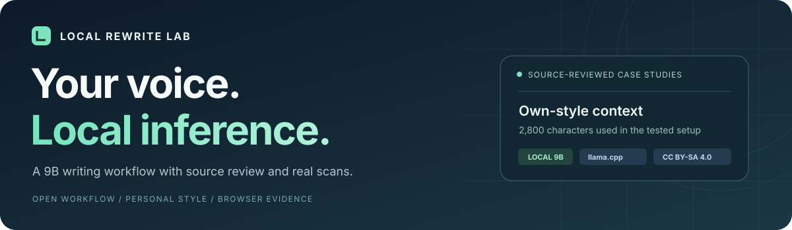
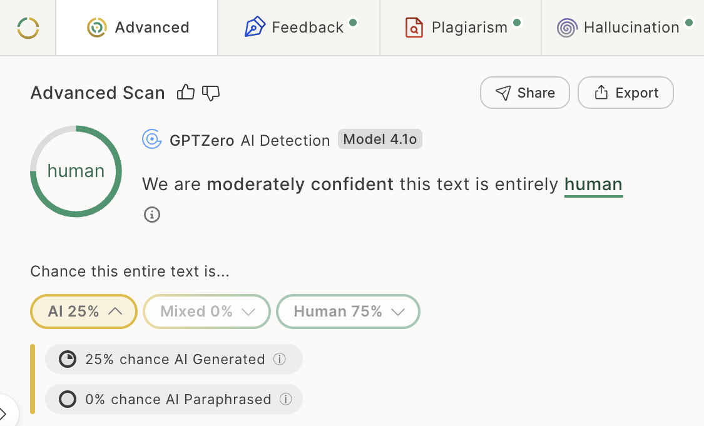
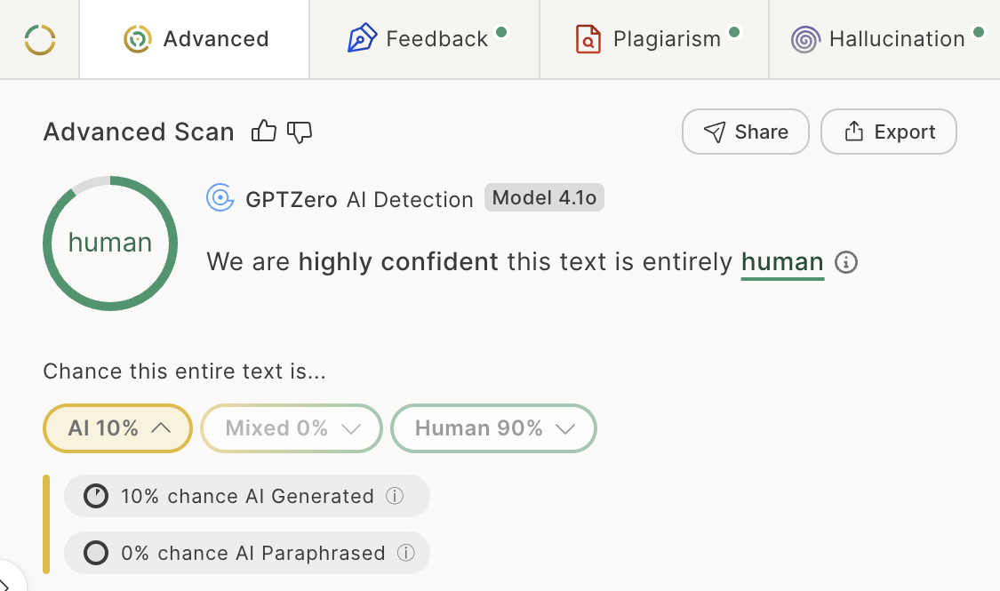
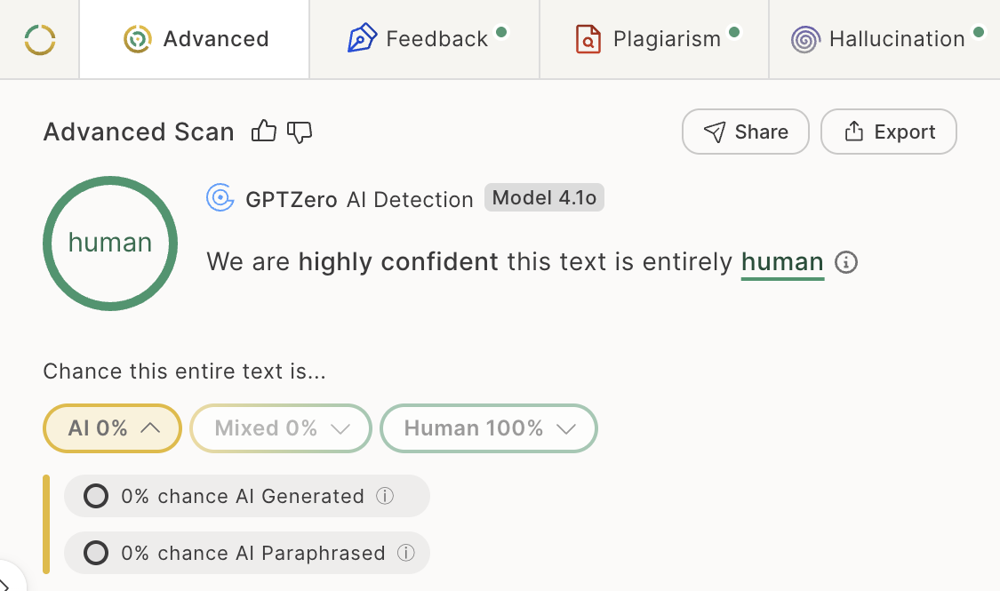
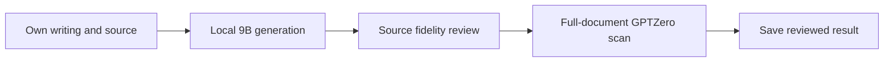

<p align="center">
  <strong>English</strong> &nbsp;·&nbsp; <a href="README.zh-CN.md">简体中文</a>
</p>

<p align="center">
  
</p>

<p align="center">
  <a href="https://huggingface.co/bartowski/Gemma-2-Ataraxy-9B-GGUF"></a>
  
  
  <a href="LICENSE"></a>
</p>

# Rewrite with your own voice. Run it locally.

<p><a href="RUNBOOK.md">Get started</a> &nbsp; / &nbsp; <a href="PERSONAL_CORPUS.md">Prepare your style</a> &nbsp; / &nbsp; <a href="EVALUATION.md">Evaluation</a> &nbsp; / &nbsp; <a href="NOTICE.md">License & sources</a></p>

**Source-reviewed documents across different technical and analytical topics received Human or Uncertain classifications in GPTZero. The showcased Human-classified cases reached 75%–100% Human probability.**

This project shares pinned local Ataraxy-9B and Qwen3-4B HIP configurations, model preparation, batch runners and a source-review/reassembly workflow. Generate one-pass candidates, check them against the source, then compare complete documents in GPTZero.

<p><sub>An iterative local-rewriting experiment · Updated November 2, 2026 · <a href="DEVELOPMENT.md">Development notes</a></sub></p>

## Complete reproduction guide

[Complete reproduction guide](QUICKSTART.md) · [Fixed versions / 固定版本](model_versions.json) · [Selective second stage / 选择性组合](SELECTIVE_REWRITE.md)

```sh
git clone https://github.com/Yed-13/local-rewrite-lab.git
cd local-rewrite-lab
PYTHON=python3.11 sh bootstrap.sh all
```


## Hardware guidance

| Configuration | Estimated minimum system memory | Recommended system memory | Suggested free SSD space |
|---|---:|---:|---:|
| HIP · Qwen3-4B Q6_K + f16 adapter | 8GB | 16GB+ | 12GB+ |
| Ataraxy · 9B Q5_K_M | 16GB | 24GB+ | 15GB+ |
| Both profiles, loaded sequentially | 16GB | 24–32GB+ | 25GB+ |

These are planning estimates for the bundled single-slot contexts (HIP 2,048; Ataraxy 8,192 tokens), based on weight sizes plus cache, runtime and operating-system headroom; they are not measured hardware minima. System memory means RAM or unified memory, not GPU VRAM. Larger contexts, parallel requests and other applications increase requirements.

A modern 64-bit ARM64 or x86-64 processor with 4+ cores is a practical starting point; 8+ cores are preferable for CPU inference. A discrete GPU is optional. For full GPU offload, budget approximately 8GB VRAM for HIP and 12–16GB for Ataraxy; smaller GPUs can use partial offload with enough host RAM. Apple Silicon uses shared unified memory, so do not add the RAM and VRAM figures together. CPU-only operation is available with `GPU_LAYERS=0`, with lower throughput.

Use the appropriate [llama.cpp backend](https://github.com/ggml-org/llama.cpp/blob/master/docs/build.md): Metal for Apple Silicon, CUDA for compatible NVIDIA GPUs, or a supported alternative backend. The bootstrap does not automatically enable CUDA; point `LLAMA_SERVER` to a separately built compatible binary. Weight sizes are listed in the [Ataraxy model card](https://huggingface.co/bartowski/Gemma-2-Ataraxy-9B-GGUF) and the pinned [model configuration](model_versions.json).

## 01 / Measured outcomes

| Incident response | Healthcare data ethics | Penetration testing |
|---|---|---|
|  |  |  |

| Showcased cases | Human probability range |
|---|---:|
| Human-classified cases | 75%–100% |
| Uncertain cases | 43%–44% |

GPTZero Advanced AI Scan · Model 4.1o. [Full comparison](EVALUATION.md) · [Results](evidence/results.csv) · [Cross-detector checks](CROSS_DETECTOR.md)

## Why run it locally?

| Advantage | What the workflow provides |
|---|---|
| Low recurring cost | Reuse your own computer and downloaded weights. Local rewriting has no per-token API charge and requires no new model training. |
| Local control of your writing | Source text, personal style samples and candidates stay on your machine during generation. The bundled server binds to localhost. |
| Small personal corpus | The tested voice configuration uses just 2,800 characters of self-authored prose, approximately 467 words. Direct mode needs no style sample. |
| Easy to repeat and inspect | TXT/JSONL batch input, saved parameters and side-by-side source/candidate files make the process reusable. |
| Content comes first | Review quantities, terminology, citations and reasoning before selecting a final version. |

Local generation can run offline after dependencies and weights are installed. Online detector scans are a separate step: the service receives the text you submit, while your style sample can remain local. Hardware, electricity and optional detector subscriptions have their own costs.

### Across more detection platforms

The source-reviewed HIP profile now has additional native-score comparisons:

| Service | Completed scope | Reviewed native score |
|---|---|---:|
| ZeroGPT | 3 complete documents | 11.8%–36.4% AI GPT* |
| Grammarly | 1 complete-document pair | 19% appears AI-generated |
| Originality.ai | 3 complete documents | 65%–90% Likely AI; one Mixed classification |
| Sapling | 3 matched paragraph groups | 3.9%–99.9% AI-detection score |
| Winston AI | 3 matched paragraph groups | 97%–100% Human Score |
| Copyleaks | 2 matched paragraph groups | 0% AI Content |

Ranges show the observed minimum and maximum. [Paired results, key screenshots and platform coverage](EXPANDED_EVALUATION.md) · [Native data](evidence/expanded_detector_results.csv)

## 02 / Built around the writer

<table>
<tr>
<td width="33%" valign="top"><h3>Short style context</h3><p>2,800 characters of older prose in the tested setup, approximately 467 words.</p></td>
<td width="33%" valign="top"><h3>Local 9B inference</h3><p>Quantized weights with llama.cpp. No rewriting-model API key.</p></td>
<td width="33%" valign="top"><h3>Source review included</h3><p>Save the source and candidates, check meaning, then run real detector comparisons.</p></td>
</tr>
</table>

TXT and JSONL batch inputs produce source text, candidates and parameters for side-by-side review.

Keep personal writing, source documents and generated results in the local `private/` and `runs/` directories.

Optional model comparison: [HIP profile for QuillBot](HIP_PROFILE.md), with three source-reviewed full-document comparisons and a separate batch runner. [Model-order comparison](COMBINATIONS.md).

## 03 / Prepare your writing sample

Start by preparing one self-authored English piece of roughly 500–1,000 words, preferably in a similar register to the target document. Save its body text as `private/my_style.txt`, removing names, student IDs, task instructions, references and long third-party quotations.

The first 2,800 characters provide the style context. Place your most suitable passage at the beginning of the file.

Omit the style file for direct mode. See [corpus preparation](PERSONAL_CORPUS.md) for selection and storage details.

## 04 / Run locally



Install Python 3 and llama.cpp for your backend, with `llama-server` available. Download [bartowski's Gemma-2-Ataraxy-9B Q5_K_M GGUF](https://huggingface.co/bartowski/Gemma-2-Ataraxy-9B-GGUF) separately. The model file is approximately 6.65GB and is not included in the repository.

```sh
export MODEL_GGUF=/absolute/path/Gemma-2-Ataraxy-9B-Q5_K_M.gguf
sh start_server.sh
```

Prepare natural paragraph groups of roughly 100–320 words in TXT or JSONL. Each JSONL record contains `id` and `text`. Keep headings, tables, code, direct quotations and references in the original document for reassembly.

```sh
python3 rewrite.py private/sections.jsonl runs/voice --style private/my_style.txt
python3 rewrite.py private/sections.jsonl runs/direct
```

Check quantities, terminology, citations and reasoning against the source. Place the reviewed paragraphs in a copy of the original document, retaining headings, tables and references.

Compare original and reviewed full documents in the same logged-in Chrome account and scan mode. Record the actual classification and Human/Mixed/AI probabilities.

See [the runbook](RUNBOOK.md) for implementation steps and data flow.

<details>
<summary><strong>Expand: tested runtime configuration</strong></summary>

temperature 0.8, top_p 0.95, top_k 40, min_p 0.05, repeat_penalty 1.05, seed 42, n_predict 1100, context 8192, one slot.

</details>

## 05 / Share and build on it

Project-authored code, documentation and diagrams use [CC BY-SA 4.0](LICENSE). Give attribution, indicate changes, and share adaptations under the license's ShareAlike terms. Model weights and third-party interface elements retain their respective rights; see [license scope](NOTICE.md).

<p align="center"><sub>Local Rewrite Lab · Local inference. Your own expression.</sub></p>

[Selective rewriting: three-document transfer and native scores](SELECTIVE_REWRITE.md)
