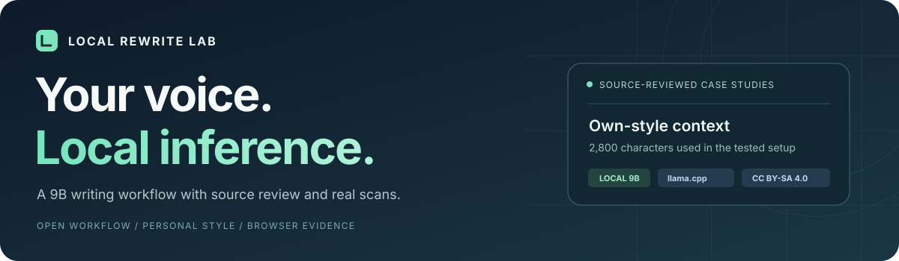
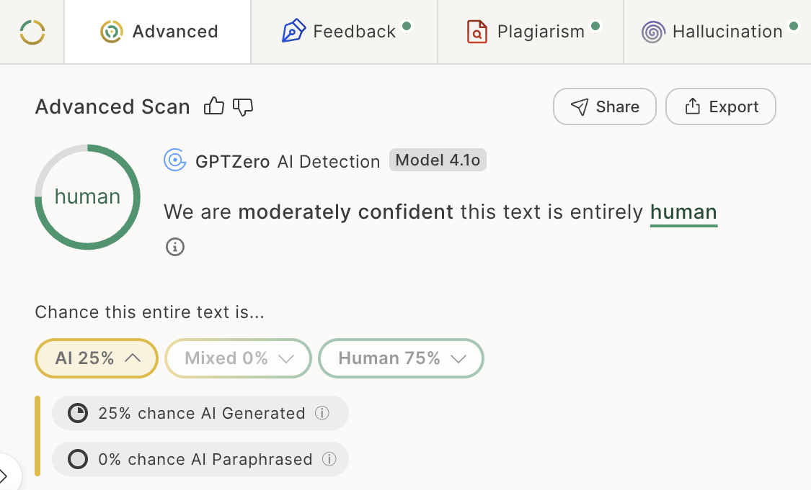
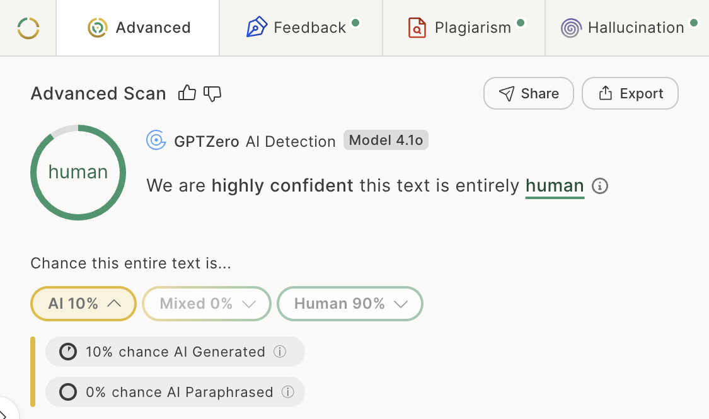
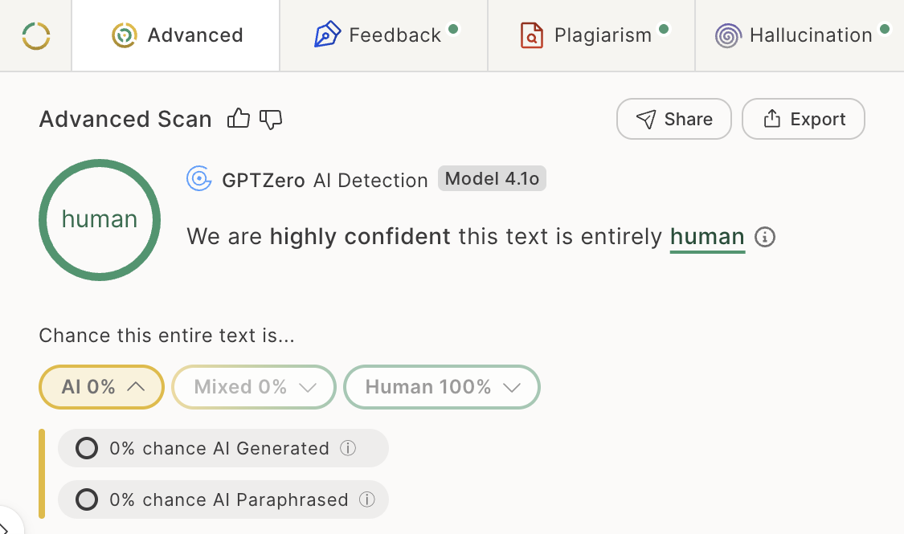

<p align="center">
  <strong>简体中文</strong> &nbsp;·&nbsp; <a href="README.md">English</a>
</p>

<p align="center">
  
</p>

<p align="center">
  <a href="https://huggingface.co/bartowski/Gemma-2-Ataraxy-9B-GGUF"></a>
  
  
  <a href="LICENSE"></a>
</p>

# 让英文稿件更贴近你自己的表达

<p><a href="RUNBOOK.md">开始运行</a> &nbsp; / &nbsp; <a href="PERSONAL_CORPUS.md">语料准备</a> &nbsp; / &nbsp; <a href="EVALUATION.md">实验记录</a> &nbsp; / &nbsp; <a href="NOTICE.md">许可与来源</a></p>

**多篇不同主题的已核对稿件获得 GPTZero Human 或 Uncertain 分类。展示的 Human 分类案例，Human 概率为 75%–100%。**

本项目公开 Gemma-2-Ataraxy-9B 的本地配置、改写提示、批处理脚本和原意核对流程。使用本人旧作作风格参考，一轮生成候选，再核对事实与表述，最后通过真实 GPTZero 全文实测选择版本。

<p><sub>分阶段迭代的本地改写实验 · 更新于 2026 年 11 月 2 日 · <a href="DEVELOPMENT.md">开发记录</a></sub></p>

## 从零开始：完整复现指南

[从零开始：完整复现指南](QUICKSTART.zh-CN.md) · [Fixed versions / 固定版本](model_versions.json) · [Selective second stage / 选择性组合](SELECTIVE_REWRITE.md)

```sh
git clone https://github.com/Yed-13/local-rewrite-lab.git
cd local-rewrite-lab
PYTHON=python3.11 sh bootstrap.sh all
```


## 01 / 实测表现

| 事件响应计划 | 医疗数据伦理 | 渗透测试讨论 |
|---|---|---|
|  |  |  |

| 展示案例 | Human 概率区间 |
|---|---:|
| Human 分类案例 | 75%–100% |
| Uncertain 分类案例 | 43%–44% |

检测：GPTZero Advanced AI Scan · 模型 4.1o。[完整对照](EVALUATION.md) · [数据表](evidence/results.csv) · [跨检测器复测](CROSS_DETECTOR.md)

## 为什么选择本地运行？

| 项目优势 | 实际提供的能力 |
|---|---|
| 持续使用成本低 | 复用自己的电脑和已下载权重，本地改写没有按 token 收取的 API 费用，也无需重新训练模型。 |
| 文稿留在自己手里 | 生成阶段的原稿、个人风格样本和候选稿均在本机处理，配套服务仅监听本机地址。 |
| 少量个人语料即可启动 | 实测风格参考仅使用 2800 字符的本人旧作，约 467 个英文词；直接模式无需风格样本。 |
| 方便批量复用和核对 | 支持 TXT／JSONL，保存参数与原文、候选，便于对照和重复运行。 |
| 将内容准确放进流程 | 选稿前核对数字、术语、引用与推理，保留作者对最终文稿的控制。 |

依赖与权重安装完成后，本地生成可离线运行。在线检测是独立步骤：检测平台会收到你提交的文本，个人风格样本可以始终保留在本机。电脑、电力及可选检测会员另有成本。

### 扩展检测平台对照

已核对的 HIP 配置新增以下原生分数对照：

| 平台 | 已完成范围 | 核对稿原生分数 |
|---|---|---:|
| ZeroGPT | 3 篇全文 | 11.8%–36.4% AI GPT* |
| Grammarly | 1 组全文配对 | 19% appears AI-generated |
| Originality.ai | 3 篇全文 | 65%–90% Likely AI；一篇为 Mixed |
| Sapling | 3 组对应完整段落 | 3.9%–99.9% AI-detection score |
| Winston AI | 3 组对应完整段落 | 97%–100% Human Score |
| Copyleaks | 2 组对应完整段落 | 0% AI Content |

区间表示本轮文本的最低与最高实测值。[逐篇对照、关键截图与平台范围](EXPANDED_EVALUATION.md) · [原生数据](evidence/expanded_detector_results.csv)

## 02 / 设计思路

<table>
<tr>
<td width="33%" valign="top"><h3>短篇本人语料</h3><p>实测使用 2800 字符的旧作参考，约 467 个英文词。</p></td>
<td width="33%" valign="top"><h3>本地模型推理</h3><p>9B 量化权重与 llama.cpp，无需改写模型 API。</p></td>
<td width="33%" valign="top"><h3>原意核对入流程</h3><p>保留源文、生成候选，核对后再用真实 GPTZero 检测。</p></td>
</tr>
</table>

支持 TXT 和 JSONL 批处理，输出原文、候选和参数，便于对照核对。

本人旧作、待改稿件和运行结果存放在本地 `private/`、`runs/` 目录。

可选模型路线：[面向 QuillBot 的 HIP 配置](HIP_PROFILE.md)，含三篇已核对全文的实测和独立批处理入口。另见[模型顺序对照](COMBINATIONS.md)。

## 03 / 个人语料准备

可先准备一篇约 500–1000 个英文词的本人旧作，保存为 UTF-8 文本 `private/my_style.txt`。优先选与目标稿件文体相近、你确认是自己写的完整正文，去掉姓名、学号、题目说明、参考文献和大段他人引文。

脚本使用前 2800 字符作为风格参考，将最合适的正文片段放在文件开头。

直接改写模式可省略风格样本。详细整理方法见 [语料准备](PERSONAL_CORPUS.md)。

## 04 / 从准备到实测


先安装 Python 3 和适合本机的 llama.cpp，确认 `llama-server` 可用。下载 [Ataraxy 9B 的 Q5_K_M GGUF](https://huggingface.co/bartowski/Gemma-2-Ataraxy-9B-GGUF)，模型文件约 6.65GB，单独存放在仓库之外。

```sh
export MODEL_GGUF=/absolute/path/Gemma-2-Ataraxy-9B-Q5_K_M.gguf
sh start_server.sh
```

把本人旧作和输入放在被忽略的 `private/` 目录。将待改正文按自然段与章节分成约 100–320 词的组；标题、表格、代码、引用原文及参考文献另行保留。JSONL 每行使用 `id` 和 `text` 字段。

```sh
python3 rewrite.py private/sections.jsonl runs/voice --style private/my_style.txt
python3 rewrite.py private/sections.jsonl runs/direct
```

对照原文核对数字、术语、引用和逻辑，将确认后的段落回填到原稿副本，保留标题、表格和参考文献。

在已登录的 Chrome 中，用同一扫描模式比较原稿和核对后的全文，记录实际分类与 Human／Mixed／AI 概率。

完整步骤与数据流向见 [运行说明](RUNBOOK.md)。

<details>
<summary><strong>展开：已实测模型参数</strong></summary>

temperature 0.8、top_p 0.95、top_k 40、min_p 0.05、repeat_penalty 1.05、seed 42、n_predict 1100，上下文 8192，单槽。

</details>

## 05 / 共享与许可

项目自有代码、文档和图示采用 [CC BY-SA 4.0](LICENSE)：署名、注明修改，并依许可要求以相同方式共享改编内容。模型权重及第三方界面元素保留其原有权利，见 [许可范围](NOTICE.md)。

<p align="center"><sub>Local Rewrite Lab · 本地推理，保留自己的表达。</sub></p>

[短文发表方向与期刊、会议区别](PUBLICATION.md) · [固定选择性改写配置及迁移实测](SELECTIVE_REWRITE.md)

[Selective rewriting: three-document transfer and native scores](SELECTIVE_REWRITE.md) · [Short-publication routes](PUBLICATION.md)
